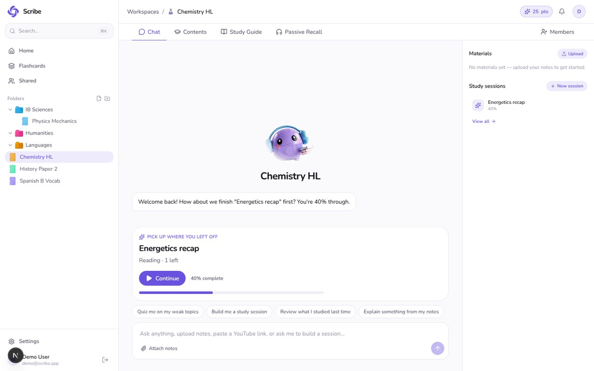
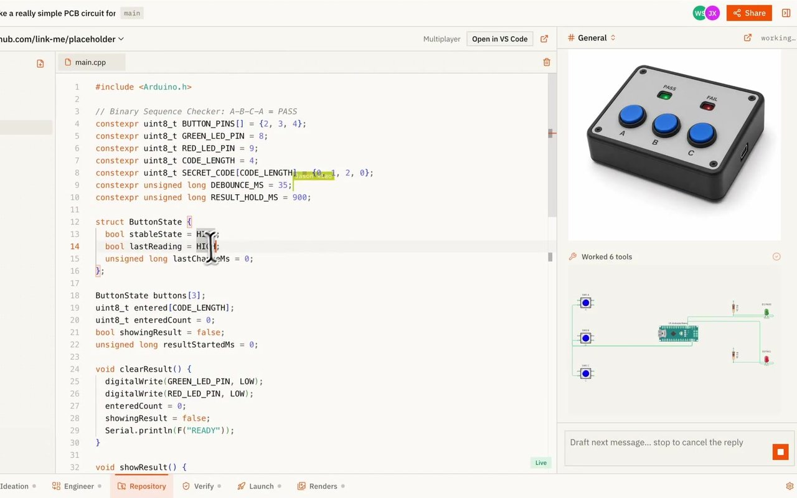
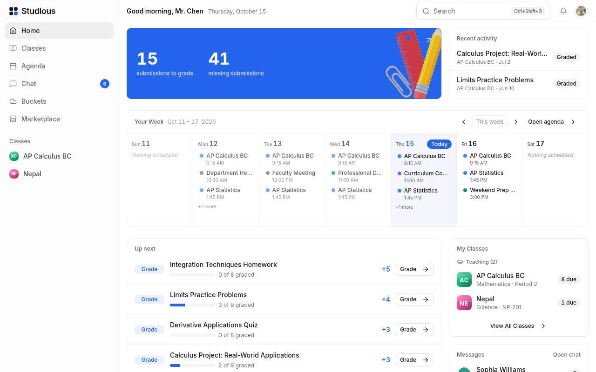
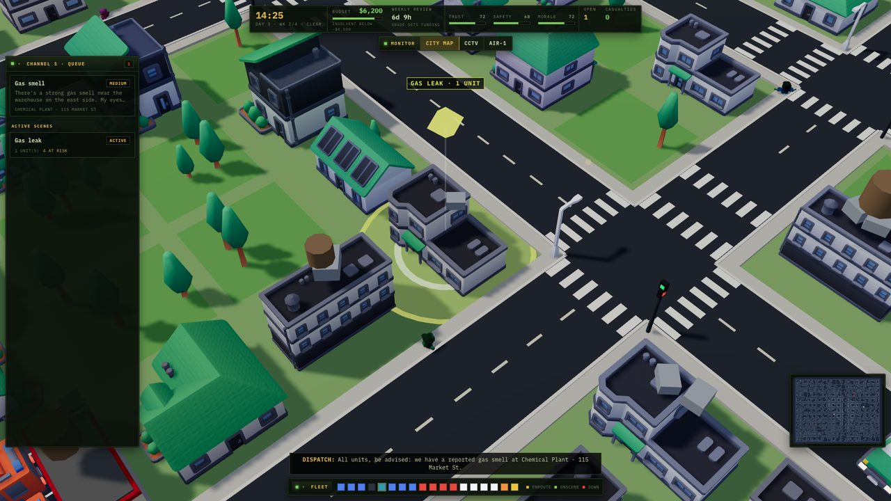
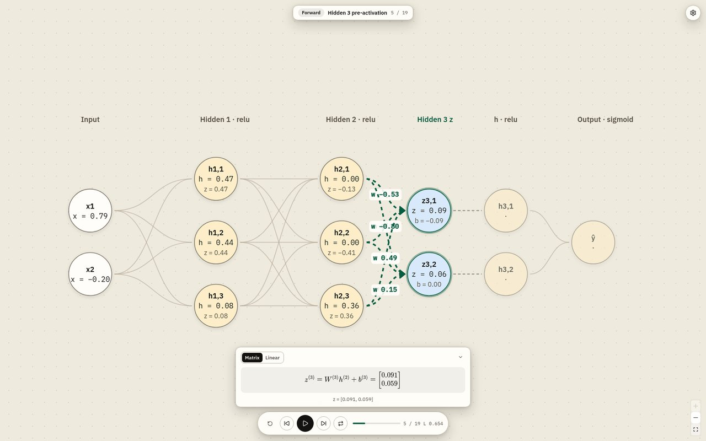
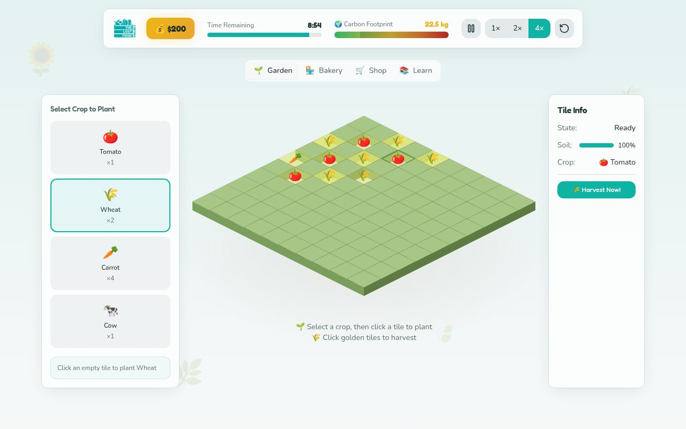

  

  
  
  
  

## 👋 Hi, I'm Alan

I'm a student in Rolle, Switzerland, and the founder of <a href="https://www.studious.sh">Studious</a> and <a href="https://scribe.study">Scribe</a>. Outside of those I mostly make side projects: small games, dev tools, ML stuff, and whatever I get curious about.

## 🔭 Currently Building

- <a href="https://github.com/alanshen27/museblet"><b>Inkform</b></a>: A webcam instrument where your body movements trigger Chinese instrument sounds and ink-style visuals. Some of the moves come from Sanda.
- <a href="https://github.com/alanshen27/aviata"><b>Aviata</b></a>: Uses ADS-B flight data to guess which private jet flights are empty legs. XGBoost plus an LSTM.
- <a href="https://github.com/alanshen27/responder"><b>Responder</b></a>: A 3D 911 dispatch game. You take calls, some of them fake, and decide which units to send.
- <a href="https://ffnn-viz.vercel.app"><b>FFNN-Viz</b></a>: A visualiser for small feed-forward neural nets. You can step through a forward pass and see the math.

## 🚀 Featured Projects

<table>
  <tr>
    <td width="50%" valign="top"><a href="https://www.studious.sh"><b>Studious</b></a> An LMS for schools. It's been live since 2023.</td>
    <td width="50%" valign="top"><a href="https://scribe.study"><b>Scribe</b></a> An AI study app. It turns your notes into study sessions, quizzes and guides.</td>
  </tr>
  <tr>
    <td valign="top"><a href="https://github.com/alanshen27/notate"><b>Notate</b></a> You write a few notes on a piano roll, a Transformer continues them, and my own synth plays it back.</td>
    <td valign="top"><a href="https://github.com/alanshen27/foundry"><b>Foundry</b></a> An AI workspace for hardware projects: brief, CAD, PCB, firmware and a store page.</td>
  </tr>
</table>

## 📸 In Action

<table>
  <tr>
    <td width="50%" align="center" valign="top"> <b>Scribe</b>: picking up a study session</td>
    <td width="50%" align="center" valign="top"> <b>Foundry</b>: firmware, 3D model and circuit for a button box</td>
  </tr>
  <tr>
    <td width="50%" align="center" valign="top"> <b>Studious</b>: the teacher dashboard</td>
    <td width="50%" align="center" valign="top"> <b>Responder</b>: a gas leak call on the map</td>
  </tr>
  <tr>
    <td width="50%" align="center" valign="top"> <b>FFNN-Viz</b>: stepping through a forward pass</td>
    <td width="50%" align="center" valign="top"> <b>EcoFarm</b>: some crops growing</td>
  </tr>
</table>

## 🧪 Experiments

<table>
  <tr>
    <td width="50%" valign="top"><a href="https://github.com/alanshen27/bao"><b>Bao</b></a> A local AI agent workspace. Everything is stored in SQLite on your machine.</td>
    <td width="50%" valign="top"><a href="https://github.com/alanshen27/brainfuck"><b>Brainfuck</b></a> A Brainfuck compiler and interpreter in C++. I wanted to compare how fast each one is.</td>
  </tr>
  <tr>
    <td valign="top"><a href="https://github.com/alanshen27/qaswarm"><b>QASwarm</b></a> Agents that write QA tests and run them with Puppeteer.</td>
    <td valign="top"><a href="https://github.com/alanshen27/mantou"><b>Mantou</b></a> Adds interactive bits to docs written for AI agents.</td>
  </tr>
  <tr>
    <td valign="top"><a href="https://github.com/alanshen27/vexmatcher"><b>VEXMatcher</b></a> Scouting tool for VEX Robotics. You enter a team number and it shows your next match.</td>
    <td valign="top"><a href="https://github.com/alanshen27/ecofarm"><b>EcoFarm</b></a> A farming game I made for the Swiss Lost Food Project.</td>
  </tr>
</table>

## 🛠️ Tools I Built for Myself

- <a href="https://github.com/alanshen27/ics-formatter"><b>ICS Formatter</b></a>: Fixes the formatting of the calendar files my school's website exports.
- <a href="https://github.com/alanshen27/notion-html-to-pdf"><b>Notion HTML to PDF</b></a>: Turns a whole folder of Notion HTML exports into PDFs.
- <a href="https://flux.alanshen.me"><b>Flux</b></a>: Upload a file, get a code, share it. No account needed.

## 🎻 Music

I play violin and piano, and I'm concertmaster of the Le Rosey Orchestra and Camerata. I also write and produce R&B songs.

  
  

## 🌊 Off the Keyboard

I swim (freestyle, IM, open water in the lake) and do Sanda. I also helped build houses in Oradea, Romania, and wrote a song for the kids there.

## 🧰 Tech Stack

  
  
  
  
  
  
  
  

  

